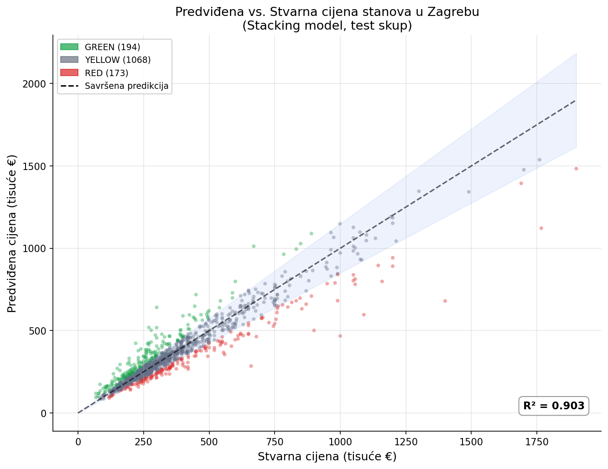
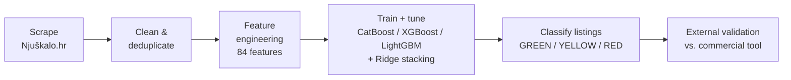
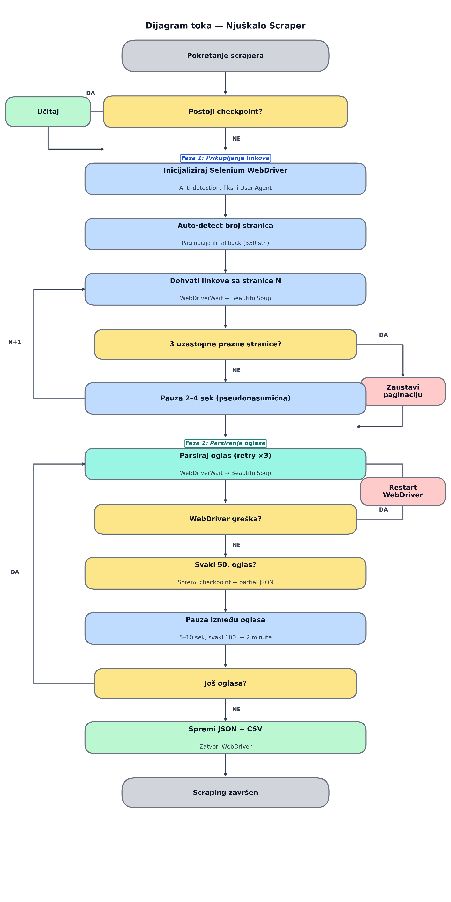
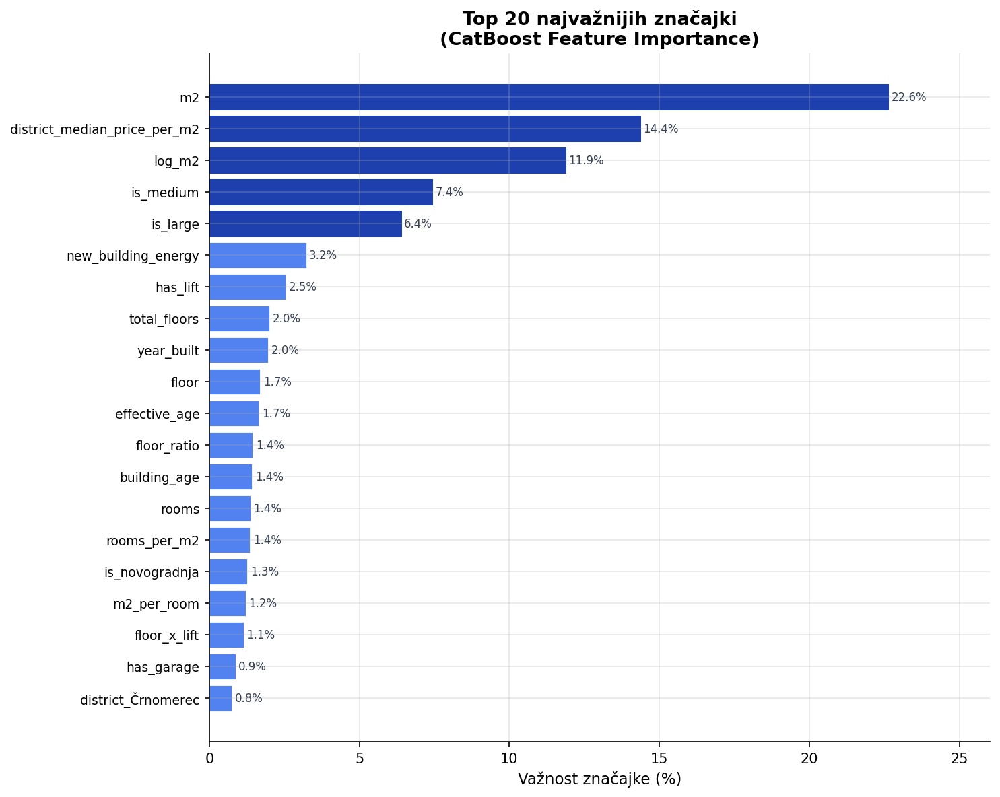
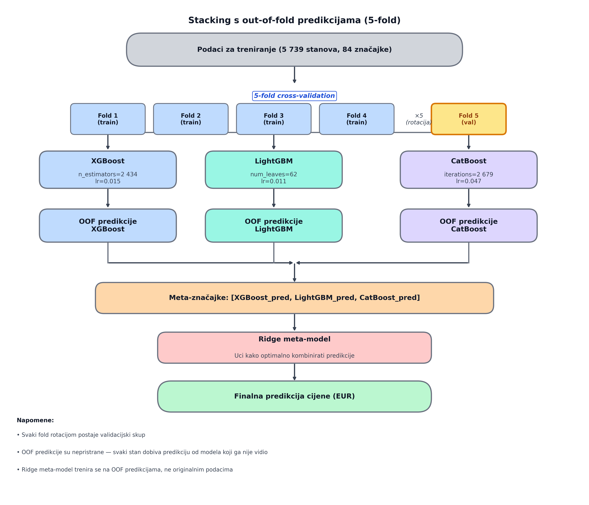
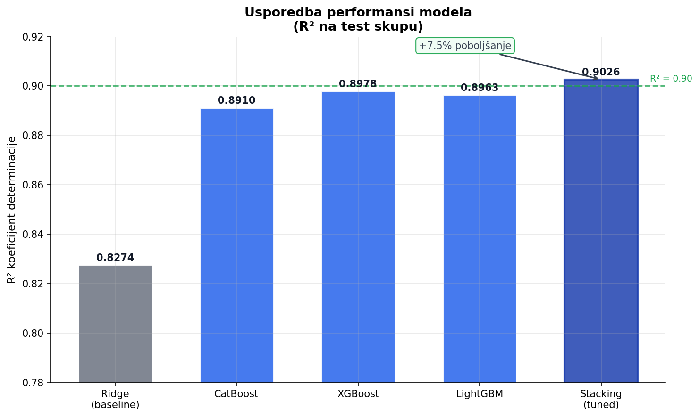

# Zagreb Real Estate Price Prediction

End-to-end machine learning pipeline for the Zagreb housing market: scrapes ~10,000 apartment
listings, engineers 84 features, trains a stacking ensemble of gradient boosting models
(**R² = 0.903** on held-out data), and flags potentially under- and overpriced listings on the
live market.

Built as my bachelor's thesis at the University of Zagreb, Faculty of Electrical Engineering
and Computing (FER), 2026. Full thesis (in Croatian): [`thesis/zavrad.pdf`](thesis/zavrad.pdf).



## Results

Evaluated on a test set of 1,435 apartments never seen during training (80/20 split):

| Model | R² | MAE | RMSE | MAPE |
|---|---|---|---|---|
| Ridge (baseline) | 0.827 | €60,445 | €101,770 | 16.6% |
| CatBoost | 0.901 | €42,207 | €73,220 | 11.7% |
| XGBoost | 0.902 | €40,954 | €72,395 | 11.4% |
| LightGBM | 0.901 | €41,654 | €73,793 | 11.5% |
| **Stacking (final)** | **0.903** | **€40,929** | **€73,397** | **11.3%** |

In practice: on a €300,000 apartment the model is off by about €34,000 on average.

## Pipeline



### 1. Data collection
A Selenium-based scraper (Njuškalo renders listings client-side, so plain HTTP scraping fails)
collected **10,050 listings** over ~48 hours. The scraper handles the site's bot policy with
randomized request pacing and User-Agent rotation, discovers attribute categories dynamically,
and checkpoints progress so interrupted runs resume instead of restarting.



### 2. Cleaning
Deduplication by listing ID (10,050 → 7,696 unique), then outlier and non-residential
filtering with fixed thresholds (price €30k–€2M, area 15–500 m², €1k–€10k per m²), yielding the
final dataset of **7,174 listings**. Numeric features are parsed out of Njuškalo's structured
text labels (e.g. `'3-sobni'` → 3 rooms, `'Prizemlje'` → floor 0).

### 3. Feature engineering (84 features)
- **Log-transformed target** (and `log_m2`) — the price distribution is heavily right-skewed
- **Median imputation + sentinel flags** (`energy_unknown`, `never_renovated`) so the model can
  distinguish real values from imputed ones; special handling for attics (`is_attic`)
- **Derived features**: `effective_age` (age vs. last renovation), `floor_ratio`,
  `rooms_per_m2`, overlapping size categories
- **28 binary amenity flags** (lift, terrace, parking, heating type, permits…)
- **10 interaction features** — e.g. `high_floor_no_lift`, `top_floor_terrace` (penthouse
  effect), `new_building_energy`
- **Location**: 17 district dummies + `district_median_price_per_m2`, the model's
  second-strongest feature (14.4% importance)



### 4. Modeling
Three gradient boosting models tuned with **Optuna** (100 trials each, 3-fold CV):

| Model | Best hyperparameters |
|---|---|
| XGBoost | `n_estimators=2434`, `learning_rate=0.015` |
| LightGBM | `num_leaves=62`, `learning_rate=0.011` |
| CatBoost | `iterations=2679`, `learning_rate=0.047` |

Their predictions feed a **Ridge meta-model** trained on 5-fold out-of-fold predictions, so the
meta-model never sees a prediction made on data the base model trained on.





### 5. Listing classification
Each listing is compared with its model-predicted fair value using out-of-fold predictions:

- **GREEN** — asking price more than 15% below predicted value (potentially underpriced): 1,034 listings (14.4%)
- **YELLOW** — within ±15% (fairly priced): 5,253 (73.2%)
- **RED** — more than 15% above (potentially overpriced): 887 (12.4%)

The ±15% threshold is deliberately wider than the model's 11.3% MAPE, so classification noise
doesn't masquerade as signal.

### 6. External validation — and an honest limitation
Nine GREEN-classified apartments were re-valued with a commercial Croatian valuation tool
(Regent AI). The comparison exposed a **systematic overestimation bias** in this model, traced
to listings mixing gross and net floor area — sellers tend to advertise the larger gross value
in the structured field our scraper reads, while the net value hides in free text. Since floor
area is the single most important feature (22.6%), this is the main obstacle to commercial-grade
accuracy. Relative ranking of listings remains consistent (both systems agree on the
*direction* of mispricing), which is what the GREEN/YELLOW/RED classification relies on.

Planned fixes: LLM-based extraction of net area from listing descriptions, address-level
geocoding instead of district granularity, and calibration against real transaction prices.

## Repository structure

```
src/
  01_scrape.py             Selenium scraper with checkpointing and bot-policy handling (Njuškalo.hr)
  02_clean.py              deduplication, outlier filtering, feature engineering (84 features)
  03_train_baselines.py    Ridge baseline + untuned CatBoost/XGBoost/LightGBM + stacking
  04_tune.py               Optuna hyperparameter search (100 trials/model) + tuned stacking
  05_evaluate.py           final test-set metrics for the tuned stacking ensemble
  06_classify.py           GREEN / YELLOW / RED classification via 5-fold OOF predictions
  07_visualize.py          thesis figures (viz_1 … viz_5)
  08_validation_sample.py  draws the sample for external validation against Regent
figures/                   plots used in the thesis and this README
thesis/                    full thesis PDF (Croatian)
```

## Data availability

The scraped dataset is **not included** in this repository: it consists of listing content
scraped from Njuškalo.hr and is not mine to redistribute. The pipeline can rebuild it from
scratch with `01_scrape.py`, subject to the site's terms. Trained model binaries are likewise
excluded; retraining takes minutes on the full dataset.

## How to run

```bash
pip install -r requirements.txt
python src/01_scrape.py             # collect listings (long-running; checkpoints automatically)
python src/02_clean.py              # build the cleaned, feature-engineered dataset
python src/03_train_baselines.py    # baseline + untuned models
python src/04_tune.py               # Optuna search (takes ~1h) + tuned stacking
python src/05_evaluate.py           # final test-set metrics
python src/06_classify.py           # classify all listings against predicted fair value
python src/07_visualize.py          # generate the figures
```

Scripts communicate through CSV/JSON/pickle files in the working directory, so run them
from the repository root in this order.

## License

MIT — see [LICENSE](LICENSE). The thesis PDF is © the author; the scraped data and the
Njuškalo.hr content it derives from remain property of their respective owners.
